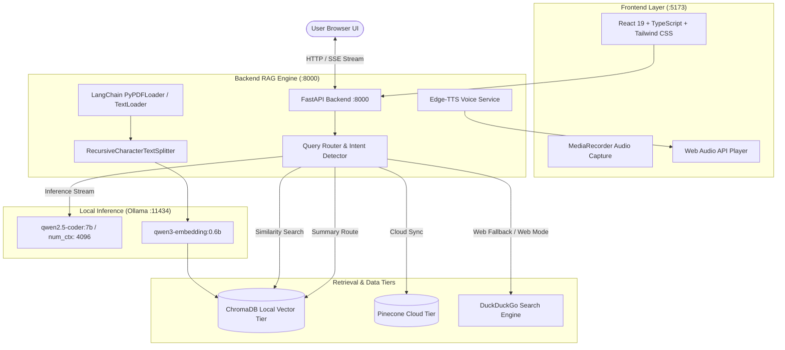

# Local RAG & Voice Assistant

[](https://fastapi.tiangolo.com)
[](https://react.dev)
[](https://vitejs.dev)
[](https://tailwindcss.com)
[](https://www.langchain.com)
[](https://ollama.ai)
[](https://www.trychroma.com)

A private, offline-capable, full-stack **Local RAG & Voice Assistant** built with a nature-tinted Claude-style dark interface. It delivers zero-cost local LLM inference, LangChain-powered document ingestion, hybrid query routing, cosine similarity and whole-document spread retrieval, real-time web search fallback, and bidirectional push-to-talk voice interactions.

---

## Screenshots


---

## Key Features

1. **Claude-Style Nature Green Dark Palette**:
   - Modern dark theme tinted in natural green tones (`#121813`, `#1a221b`, `#a8d5a2`).
   - Clean centered chat column (720px), elegant typography with serif response text, right-aligned user bubbles, and responsive drawers.
2. **Hybrid RAG Routing & Search Modes**:
   - **Auto Mode**: Fast-paths casual small talk to direct LLM generation; detects summary requests to run full-document spread retrieval; evaluates specific queries against a `0.35` similarity threshold; falls back gracefully to live DuckDuckGo web search when similarity is low or external info is needed.
   - **Web Mode**: Direct live web search queries with source URLs and real-time snippets.
   - **Docs Mode**: Strict document grounding in local vector collections without external search.
3. **Smart Ingestion & Retrieval**:
   - Ingests PDFs and text documents using LangChain document loaders (`PyPDFLoader`, `TextLoader`) with 1-based page metadata and recursive character chunking (800 chars / 150 overlap).
   - **Spread Retrieval**: Skips dense citation lists and reference sections, guarantees inclusion of the abstract and conclusion chunks, and uniformly samples across the corpus for comprehensive document overviews.
4. **Dual Vector Database Tiers**:
   - Local on-disk persistent vector store via **ChromaDB**.
   - Optional cloud vector index synchronization via **Pinecone**.
5. **Bidirectional Voice Assistant**:
   - Push-to-talk voice input via browser `MediaRecorder` audio capture sent to backend `faster-whisper` STT.
   - Neural voice audio response streaming synthesized on CPU with Edge-TTS (`0 MB` GPU memory footprint).
6. **Streaming Server-Sent Events (SSE)**:
   - Real-time token streaming with structured lifecycle events (`status`, `sources`, `token`, `done`).

---

## Documentation

For in-depth technical specifications, design patterns, and full project implementation details:
- **[Comprehensive Project Documentation](docs/PROJECT_DOCUMENTATION.md)**: Full end-to-end report on all features, hardware detection, spread retrieval, anti-hallucination engines, voice pipeline, and testing history.
- **[System Architecture & Specifications](docs/ARCHITECTURE.md)**: Data flows, sequence diagrams, SSE event schemas, spread retrieval strategy, and LangChain module mappings.

---

## System Architecture



---

## End-to-End Workflow

```
[Ingest]    PDF / Text ──> LangChain Loaders ──> Recursive Splitter ──> Embeddings ──> ChromaDB
                                                                                          │
[Retrieve]  User Query ──> Intent Classifier ─────────────────────────────────────────────┤
                                │                                                         │
                                ├─ Casual / Small Talk ──────────> Direct LLM Stream      │
                                ├─ Overview / Summary Intent ────> Spread Retrieval ──────┤
                                ├─ Specific Fact Query ──────────> Similarity Retrieval ──┤
                                └─ Real-Time / Low Score ────────> DuckDuckGo Search ─────┤
                                                                                          │
[Stream]    Grounded Prompt + Context ──> Ollama (num_ctx>=4096) ──> SSE Tokens ──> React UI
```

1. **Ingest**: Documents are parsed by LangChain loaders into page-aware Documents, partitioned by `RecursiveCharacterTextSplitter` (800 chars, 150 overlap), embedded via `qwen3-embedding:0.6b` (or Gemini/OpenAI in hosted mode), and stored in ChromaDB or Pinecone.
2. **Retrieve**: Incoming queries are classified. Summary queries trigger spread sampling across non-reference chunks; specific queries trigger cosine distance retrieval.
3. **Routing**: If similarity $\ge 0.35$ or summary intent is detected, answers are grounded in document chunks. (Cosine similarity mathematically spans $[-1.0, 1.0]$: orthogonal or opposite chunks yield zero or slightly negative scores, which are cleanly filtered out by the $0.35$ threshold). If similarity is low, query falls back to web search. Casual chat bypasses retrieval entirely.
4. **Stream**: The synthesized prompt is streamed via Server-Sent Events token-by-token directly to the React interface.

---

## Prerequisites

- **[Ollama](https://ollama.ai)** installed and running locally (for local mode).
- **Python 3.10+** (tested on Python 3.11/3.12).
- **Node.js 18+** and **npm**.
- (Optional) **Docker** and Docker Compose *(provided, not tested locally)* for containerized backend execution.

---

## Quickstart & Installation

### Option A: One-Click Setup (Windows)

If you are on Windows, the entire application can be set up and launched with two scripts:

1. **One-Click Installation**:
   Double-click or run `setup.bat`:
   ```powershell
   .\setup.bat
   ```
   *This automatically creates `backend\.env`, provisions the Python `.venv`, installs all backend packages, and installs frontend node modules.*

2. **Pull the Required Models**:
   Open a terminal and pull your preferred model (see the [Hardware Guide](#hardware--model-selection-guide) below):
   ```bash
   # Default LLM (7B parameters)
   ollama pull qwen2.5-coder:7b

   # Dense vector embedding model (Required)
   ollama pull qwen3-embedding:0.6b
   ```

3. **Launch All Services**:
   ```powershell
   .\start_all.bat
   ```
   *Boots Ollama, FastAPI backend (:8000), and Vite frontend (:5173) in dedicated windows. Open `http://localhost:5173` to start chatting!*
   To shut down all services at once, run `.\stop_all.bat`.

---

### Hardware & Model Selection Guide

Jarvis dynamically inspects your host machine's hardware on startup and provides tailored model recommendations in the **System & Environment** panel:

| Hardware Tier | Detected Specs | Recommended LLM | Memory Footprint | Pull Command |
| :--- | :--- | :--- | :--- | :--- |
| **Entry / CPU** | CPU Only or VRAM < 6GB | `llama3.2:3b` | ~2.5 GB RAM | `ollama pull llama3.2:3b` |
| **Mid-Tier (Default)** | 6GB – 10GB VRAM (e.g. RTX 3060, 4060) | `qwen2.5-coder:7b` | ~5.0 GB VRAM | `ollama pull qwen2.5-coder:7b` |
| **High-End** | 12GB+ VRAM or Apple Silicon 16GB+ | `qwen2.5-coder:14b` | ~9.0 GB VRAM | `ollama pull qwen2.5-coder:14b` |
| **Embedding (Required)** | All Configurations | `qwen3-embedding:0.6b` | ~0.6 GB RAM | `ollama pull qwen3-embedding:0.6b` |

> [!TIP]
> **Switching Models On The Fly**: You can download multiple models. Open the **System Panel** (gear icon in the top right) inside the Jarvis web app to switch active models in real time without restarting any servers!

---

### Option B: Manual Setup (macOS / Linux / Windows)

#### 1. Pull Ollama Models
Ensure Ollama is running (`ollama serve`), then pull the required models:
```bash
ollama pull qwen2.5-coder:7b
ollama pull qwen3-embedding:0.6b
```

#### 2. Configure Environment
```bash
# In the project root:
cp .env.example backend/.env
# On Windows cmd:
# copy .env.example backend\.env
```

#### 3. Backend Setup
```bash
cd backend

# Create & activate virtual environment
python -m venv .venv

# Windows:
.venv\Scripts\activate
# macOS/Linux:
source .venv/bin/activate

# Install dependencies
pip install -r requirements.txt

# Start the FastAPI server
python -m uvicorn main:app --host 127.0.0.1 --port 8000 --reload
```
API docs available at `http://127.0.0.1:8000/docs`.

#### 4. Frontend Setup
In a new terminal window:
```bash
cd frontend
npm install
npm run dev
```
Open `http://localhost:5173` in your browser.

---

## Docker Deployment (Backend) *(Provided, not tested locally)*

You can run the backend inside Docker while connecting to Ollama running on your host machine:

```bash
# Build and start backend container
docker compose up --build
```

The container maps port `8000` and configures `host.docker.internal:11434` to communicate with the host's Ollama engine.

---

## Deployment Guide (Hosted / Cloud Mode)

The architecture supports complete serverless cloud deployment by setting a few environment variables:

### 1. Backend (Python Web Host: Render, Railway, Fly.io, AWS)
Deploy the `/backend` folder using a Python 3.11/3.12 runtime with start command:
```bash
uvicorn main:app --host 0.0.0.0 --port 8000
```

#### Required Backend Environment Variables:
| Variable | Value for Hosted Mode | Notes |
| :--- | :--- | :--- |
| `LLM_PROVIDER` | `gemini` (or `openai`) | Selects cloud LLM provider |
| `EMBEDDING_PROVIDER` | `gemini` (or `openai`) | Selects cloud embedding provider |
| `LLM_MODEL` | `gemini-1.5-flash` / `gemini-2.0-flash` | Cloud chat model name |
| `EMBEDDING_MODEL` | `text-embedding-004` | Matching cloud embedding model |
| `VECTOR_BACKEND` | `pinecone` | Serverless vector backend (no local disk needed) |
| `PINECONE_API_KEY` | `your-pinecone-key` | Pinecone authentication |
| `PINECONE_INDEX_NAME` | `rag-chatbot` | Auto-created if it does not exist |
| `GOOGLE_API_KEY` | `AIzaSy...` | Required when `LLM_PROVIDER=gemini` |
| `OPENAI_API_KEY` | `sk-...` | Required when `LLM_PROVIDER=openai` |
| `STT_ENABLED` | `false` | Disables heavy local Whisper dependencies in cloud |
| `CORS_ORIGINS` | `https://your-frontend.vercel.app` | Comma-separated allowed web origins |
| `RATE_LIMIT_PER_MIN`| `60` | Per-client rate limit (reads first IP from `X-Forwarded-For`) |
| `MAX_UPLOAD_MB` | `20` | Maximum file upload size limit |

> [!IMPORTANT]
> **SSE Reverse-Proxy Buffering Notice**:
> When running behind a reverse proxy (Nginx, Cloudflare, AWS ALB, Render), proxy response buffering must be disabled for Server-Sent Events to stream tokens with zero latency.
> The backend sets `X-Accel-Buffering: no` on streaming responses. If using custom Nginx, ensure `proxy_buffering off;` is configured for the `/api/chat` route.

---

### 2. Frontend (Vercel, Netlify, Cloudflare Pages)
Deploy the `/frontend` directory to Vercel:
- **Build Command**: `npm run build`
- **Output Directory**: `dist`
- **Environment Variable**:
  - `VITE_API_BASE_URL`: `https://your-backend.onrender.com` (URL of your deployed backend)

---

## Configuration Reference

The following environment variables can be configured in `.env`:

| Variable | Default | Description |
| :--- | :--- | :--- |
| `LLM_PROVIDER` | `ollama` | Active provider: `ollama`, `gemini`, or `openai`. |
| `EMBEDDING_PROVIDER` | `ollama` | Active embedding provider: `ollama`, `gemini`, or `openai`. |
| `VECTOR_BACKEND` | `chroma` | Vector backend: `chroma` (local) or `pinecone` (serverless cloud). |
| `OLLAMA_BASE_URL` | `http://127.0.0.1:11434` | URL of the local or remote Ollama server. |
| `LLM_MODEL` | `qwen2.5-coder:7b` | LLM model identifier for chat completions. |
| `EMBEDDING_MODEL` | `qwen3-embedding:0.6b` | Model used to compute vector embeddings. |
| `OLLAMA_NUM_CTX` | `4096` | Context window allocated for Ollama (applies only to Ollama). |
| `SIMILARITY_THRESHOLD` | `0.35` | Minimum cosine similarity required to trigger document RAG. |
| `CHROMA_PERSIST_DIR` | `./chroma_db` | Filesystem path for local ChromaDB storage. |
| `PINECONE_API_KEY` | `""` | Pinecone API key. |
| `PINECONE_INDEX_NAME` | `attention-paper` | Pinecone index name (auto-created if missing). |
| `GOOGLE_API_KEY` | `""` | Google Gemini API key (never logged). |
| `OPENAI_API_KEY` | `""` | OpenAI API key (never logged). |
| `LLM_BASE_URL` | `""` | Optional base URL for OpenAI-compatible providers (Groq, DeepSeek). |
| `STT_ENABLED` | `true` | Enables speech-to-text. When `false`, PyAV/Whisper are never loaded. |
| `VOICE_TTS_VOICE` | `en-US-AriaNeural` | Default neural voice model for Edge-TTS speech synthesis. |
| `CORS_ORIGINS` | `http://localhost:5173,...` | Comma-separated list of allowed frontend origins. |
| `RATE_LIMIT_PER_MIN` | `0` (disabled) | Per-IP rate limit per minute. Uses `X-Forwarded-For` when behind proxies. |
| `MAX_UPLOAD_MB` | `20` | Maximum file upload size in megabytes. |

---

## Project Structure

```
Rag_ChatBot/
├── backend/
│   ├── data/                 # Ingested raw documents (PDFs, TXT)
│   ├── routers/              # FastAPI API route modules
│   │   ├── chat.py           # SSE streaming chat & query classification
│   │   ├── documents.py      # LangChain document loaders & ingestion
│   │   ├── models.py         # Ollama model discovery & hardware info
│   │   ├── sync.py           # Pinecone cloud synchronization
│   │   └── voice.py          # Edge-TTS voice synthesis & Whisper transcription
│   ├── services/             # Core business logic & RAG engine
│   │   ├── hardware_service.py # GPU/Metal/CPU hardware detection
│   │   └── rag_service.py    # ChromaDB, LangChain, spread & similarity retrieval
│   ├── config.py             # Pydantic environment settings
│   ├── Dockerfile            # Container build specification
│   ├── main.py               # FastAPI application entrypoint
│   └── requirements.txt      # Pinned Python package dependencies
├── docs/
│   ├── ARCHITECTURE.md          # Technical architecture & retrieval specifications
│   ├── PROJECT_DOCUMENTATION.md # Comprehensive end-to-end project report
│   └── screenshots/             # Interface screenshots for documentation
├── frontend/
│   ├── src/
│   │   ├── components/       # ChatArea, Sidebar, Header, Drawers, VoiceControls
│   │   ├── hooks/            # useChat, useSpeechRecognition, useAudioPlayer
│   │   ├── services/         # API clients and SSE event parsers
│   │   ├── types/            # TypeScript interfaces & SSE schemas
│   │   ├── index.css         # Nature green dark palette & design tokens
│   │   └── App.tsx           # Main application root
│   ├── index.html
│   ├── package.json
│   └── vite.config.ts
├── docker-compose.yml        # Docker composition for backend service
├── start_all.bat             # Windows 3-in-1 startup script
├── stop_all.bat              # Windows teardown script
├── .env.example              # Sample environment configuration template
├── .gitignore                # Git exclusions (credentials, databases, venvs)
└── README.md                 # Project documentation
```

---

## Known Limitations

1. **Local Model Hardware Requirements**: Running `qwen2.5-coder:7b` with a 4096-token context window performs best with at least 6GB-8GB of dedicated VRAM. For systems with lower VRAM, consider switching to `llama3.2:3b`.
2. **Speech-to-Text (STT) Processing**: Voice recording captures audio using the standard browser `MediaRecorder` API and transcribes it on backend CPU with `faster-whisper`. When deployed to low-spec cloud instances or serverless hosts without PyAV/Torch, set `STT_ENABLED=false` to prevent importing STT dependencies and conserve compute.
3. **DuckDuckGo Rate Limits**: When relying extensively on web search fallback, DuckDuckGo may occasionally throttle high-frequency automated requests.
4. **Pinecone Cloud Index Dimensions**: In Pinecone primary mode, indexes are auto-created with the dimension matching your active embedding model (768 for Gemini `text-embedding-004`, 1024 for Ollama `qwen3-embedding:0.6b`, 1536 for OpenAI `text-embedding-3-small`). If using a pre-existing index, its dimension must match the active model.

---

## License

MIT License. Open for educational, personal, and commercial development.
