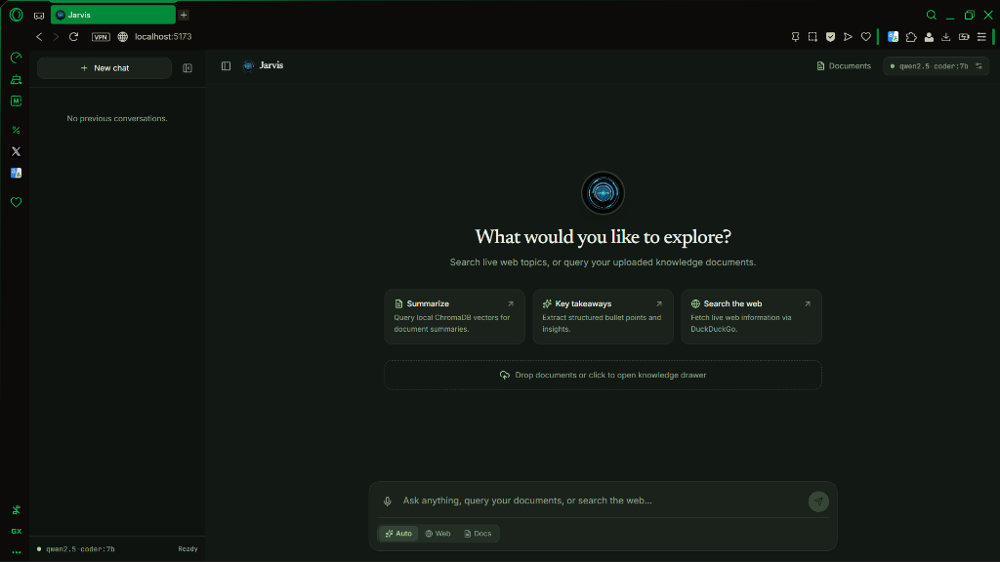

# 🌿 Local RAG & Voice Assistant

[](https://fastapi.tiangolo.com)
[](https://react.dev)
[](https://vitejs.dev)
[](https://tailwindcss.com)
[](https://www.langchain.com)
[](https://ollama.ai)
[](https://www.trychroma.com)

A private, offline-capable, full-stack **Local RAG & Voice Assistant** built with a nature-tinted Claude-style dark interface. It delivers zero-cost local LLM inference, LangChain-powered document ingestion, hybrid query routing, cosine similarity and whole-document spread retrieval, real-time web search fallback, and bidirectional push-to-talk voice interactions.

---

## 📸 Screenshots

<!-- Place screenshots or recording demos below -->
> [!NOTE]
> *Screenshots Placeholder:*
> 
> 
> *(To add your own screenshot, place an image at `docs/screenshots/chat_interface.png`)*

---

## ✨ Key Features

1. **Claude-Style Nature Green Dark Palette**:
   - Modern dark theme tinted in natural green tones (`#121813`, `#1a221b`, `#a8d5a2`).
   - Clean centered chat column (720px), elegant typography with serif response text, right-aligned user bubbles, and responsive drawers.
2. **Hybrid RAG Routing & Search Modes**:
   - **⚡ Auto Mode**: Fast-paths casual small talk to direct LLM generation; detects summary requests to run full-document spread retrieval; evaluates specific queries against a `0.35` similarity threshold; falls back gracefully to live DuckDuckGo web search when similarity is low or external info is needed.
   - **🌐 Web Mode**: Direct live web search queries with source URLs and real-time snippets.
   - **📄 Docs Mode**: Strict document grounding in local vector collections without external search.
3. **Smart Ingestion & Retrieval**:
   - Ingests PDFs and text documents using LangChain document loaders (`PyPDFLoader`, `TextLoader`) with 1-based page metadata and recursive character chunking (800 chars / 150 overlap).
   - **Spread Retrieval**: Skips dense citation lists and reference sections, guarantees inclusion of the abstract and conclusion chunks, and uniformly samples across the corpus for comprehensive document overviews.
4. **Dual Vector Database Tiers**:
   - Local on-disk persistent vector store via **ChromaDB**.
   - Optional cloud vector index synchronization via **Pinecone**.
5. **Bidirectional Voice Assistant**:
   - Push-to-talk voice input via browser Web Speech recognition or server-side Whisper transcription.
   - Neural voice audio response streaming synthesized on CPU with Edge-TTS (`0 MB` GPU memory footprint).
6. **Streaming Server-Sent Events (SSE)**:
   - Real-time token streaming with structured lifecycle events (`status`, `sources`, `token`, `done`).

---

## 🏛️ System Architecture


---

## 🔄 End-to-End Workflow

```
[Ingest]    PDF / Text ──> LangChain Loaders ──> Recursive Splitter ──> Embeddings ──> ChromaDB
                                                                                          │
[Retrieve]  User Query ──> Intent Classifier ─────────────────────────────────────────────┤
                                │                                                         │
                                ├─ Casual / Small Talk ──────────> Direct LLM Stream      │
                                ├─ Overview / Summary Intent ────> Spread Retrieval ──────┤
                                ├─ Specific Fact Query ──────────> Similarity Retrieval ──┤
                                └─ Real-Time / Low Score ────────> DuckDuckGo Search ─────┤
                                                                                          │
[Stream]    Grounded Prompt + Context ──> Ollama (num_ctx>=4096) ──> SSE Tokens ──> React UI
```

1. **Ingest**: Documents are parsed by LangChain loaders into page-aware Documents, partitioned by `RecursiveCharacterTextSplitter` (800 chars, 150 overlap), embedded via `qwen3-embedding:0.6b`, and stored in ChromaDB.
2. **Retrieve**: Incoming queries are classified. Summary queries trigger spread sampling across non-reference chunks; specific queries trigger cosine distance retrieval.
3. **Routing**: If similarity $\ge 0.35$ or summary intent is detected, answers are grounded in document chunks. If similarity is low, query falls back to web search. Casual chat bypasses retrieval entirely.
4. **Stream**: The synthesized prompt is streamed via Server-Sent Events token-by-token directly to the React interface.

---

## 📋 Prerequisites

- **[Ollama](https://ollama.ai)** installed and running locally.
- **Python 3.10+** (tested on Python 3.11/3.12).
- **Node.js 18+** and **npm**.
- (Optional) **Docker** and Docker Compose for containerized backend execution.

---

## 🚀 Setup & Installation

### 1. Pull Ollama Models

Ensure Ollama is running (`ollama serve`), then pull the required models:

```bash
# LLM Generation Model (7B parameters, 4096+ context window)
ollama pull qwen2.5-coder:7b

# Dense Vector Embedding Model
ollama pull qwen3-embedding:0.6b
```

*(For lightweight machines or CPU-only setups, you can alternatively use `ollama pull llama3.2:3b` and `ollama pull nomic-embed-text`)*

---

### 2. Configure Environment

Copy the example environment file:

```bash
# In the project root or backend directory:
copy .env.example backend\.env
```

Review and adjust any desired variables in `backend/.env`.

---

### 3. Backend Setup

```bash
cd backend

# Create virtual environment
python -m venv .venv

# Activate virtual environment
# Windows:
.venv\Scripts\activate
# macOS/Linux:
source .venv/bin/activate

# Install pinned dependencies
pip install -r requirements.txt

# Start the FastAPI server
python -m uvicorn main:app --host 127.0.0.1 --port 8000 --reload
```

The backend API will be available at `http://127.0.0.1:8000` (interactive OpenAPI documentation at `/docs`).

---

### 4. Frontend Setup

In a new terminal window:

```bash
cd frontend

# Install node modules
npm install

# Start Vite dev server
npm run dev
```

Open your browser to `http://localhost:5173`.

---

### ⚡ One-Click Startup (Windows)

From the project root directory (`Rag_ChatBot`):

```powershell
.\start_all.bat
```

To stop all background processes:
```powershell
.\stop_all.bat
```

> [!TIP]
> Ensure your terminal is in the repository root folder (`c:\Users\<user>\...\Rag_ChatBot`) before running `.\start_all.bat`.

---

## 🐳 Docker Deployment (Backend)

You can run the backend inside Docker while connecting to Ollama running on your host machine:

```bash
# Build and start backend container
docker compose up --build
```

The container maps port `8000` and configures `host.docker.internal:11434` to communicate with the host's Ollama engine.

---

## ⚙️ Configuration Reference

The following environment variables can be configured in `.env`:

| Variable | Default | Description |
| :--- | :--- | :--- |
| `OLLAMA_BASE_URL` | `http://127.0.0.1:11434` | URL of the local or remote Ollama server. |
| `LLM_MODEL` | `qwen2.5-coder:7b` | Ollama model identifier used for chat completions. |
| `EMBEDDING_MODEL` | `qwen3-embedding:0.6b` | Model used to compute vector embeddings. |
| `OLLAMA_NUM_CTX` | `4096` | Context window size allocated for Ollama chat generation. |
| `SIMILARITY_THRESHOLD` | `0.35` | Minimum cosine similarity required to trigger document RAG. |
| `CHROMA_PERSIST_DIRECTORY` | `./chroma_db` | Filesystem path for local ChromaDB vector storage. |
| `PINECONE_API_KEY` | `""` | Optional API key for cloud vector synchronization. |
| `PINECONE_INDEX_NAME` | `attention-paper` | Name of the Pinecone index for cloud sync. |
| `VOICE_TTS_VOICE` | `en-US-AriaNeural` | Default neural voice model for Edge-TTS speech synthesis. |

---

## 📁 Project Structure

```
Rag_ChatBot/
├── backend/
│   ├── data/                 # Ingested raw documents (PDFs, TXT)
│   ├── routers/              # FastAPI API route modules
│   │   ├── chat.py           # SSE streaming chat & query classification
│   │   ├── documents.py      # LangChain document loaders & ingestion
│   │   ├── models.py         # Ollama model discovery & hardware info
│   │   ├── sync.py           # Pinecone cloud synchronization
│   │   └── voice.py          # Edge-TTS voice synthesis & Whisper transcription
│   ├── services/             # Core business logic & RAG engine
│   │   ├── hardware_service.py # GPU/Metal/CPU hardware detection
│   │   └── rag_service.py    # ChromaDB, LangChain, spread & similarity retrieval
│   ├── config.py             # Pydantic environment settings
│   ├── Dockerfile            # Container build specification
│   ├── main.py               # FastAPI application entrypoint
│   └── requirements.txt      # Pinned Python package dependencies
├── docs/
│   └── ARCHITECTURE.md       # Detailed technical architecture specification
├── frontend/
│   ├── src/
│   │   ├── components/       # ChatArea, Sidebar, Header, Drawers, VoiceControls
│   │   ├── hooks/            # useChat, useSpeechRecognition, useAudioPlayer
│   │   ├── services/         # API clients and SSE event parsers
│   │   ├── types/            # TypeScript interfaces & SSE schemas
│   │   ├── index.css         # Nature green dark palette & design tokens
│   │   └── App.tsx           # Main application root
│   ├── index.html
│   ├── package.json
│   └── vite.config.ts
├── docker-compose.yml        # Docker composition for backend service
├── start_all.bat             # Windows 3-in-1 startup script
├── stop_all.bat              # Windows teardown script
├── .env.example              # Sample environment configuration template
├── .gitignore                # Git exclusions (credentials, databases, venvs)
└── README.md                 # Project documentation
```

---

## ⚠️ Known Limitations

1. **Local Model Hardware Requirements**: Running `qwen2.5-coder:7b` with a 4096-token context window performs best with at least 6GB-8GB of dedicated VRAM. For systems with lower VRAM, consider switching to `llama3.2:3b`.
2. **Browser Speech Recognition**: Voice recognition uses the browser's native `webkitSpeechRecognition` API, which works best in Chromium-based browsers (Chrome, Edge, Brave). On unsupported browsers, fallback to audio upload transcription is provided.
3. **DuckDuckGo Rate Limits**: When relying extensively on web search fallback, DuckDuckGo may occasionally throttle high-frequency automated requests.
4. **Pinecone Cloud Index Dimensions**: When syncing embeddings to Pinecone, ensure the target Pinecone index dimension matches the embedding model dimension (1024 for `qwen3-embedding:0.6b`).

---

## 📄 License

MIT License. Open for educational, personal, and commercial development.
