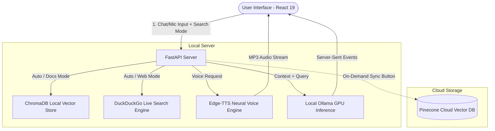

# 🧠 Local RAG & Voice Assistant

[](https://fastapi.tiangolo.com)
[](https://react.dev)
[](https://vitejs.dev)
[](https://tailwindcss.com)
[](https://ollama.ai)
[](https://www.trychroma.com)

A high-performance, full-stack **Local RAG & Voice Assistant** engineered for zero-cost, private, and portable AI execution. 

Unlike rigid chatbot templates, this system features **dynamic hardware detection** (NVIDIA GPUs, Apple Silicon Metal/MPS, or CPU), **universal model portability** (compatible with any Ollama model), **interactive search mode toggling** (Auto Smart RAG, Force Live Web Search, Documents Only), and **neural push-to-talk voice streaming**.

---

## 🌟 Key Capabilities

1. **Universal Hardware Adaptability & Dynamic Detection**
   - Automatically detects and displays the user's actual hardware: NVIDIA GPU (with VRAM capacity), Apple Silicon Metal, or CPU.
   - Adjusts automatically without hardcoded device assumptions.

2. **Universal Model Support**
   - Works out of the box with any model pulled in Ollama (`qwen2.5-coder:7b`, `llama3.2:3b`, `mistral:7b`, `deepseek-r1:8b`, etc.).
   - Includes `/api/models` endpoint for automatic discovery and real-time model switching.

3. **Three Interactive Search Modes**
   - **⚡ Auto (Smart RAG)**: Queries uploaded documents first; automatically falls back to DuckDuckGo if similarity score is below threshold or real-time info is requested.
   - **🌐 Live Web Search**: Forces DuckDuckGo web search for live real-time internet information and citations.
   - **📄 Documents Only**: Restricts answers strictly to uploaded PDFs, TXT, and Markdown files in ChromaDB.

4. **Context-Aware Push-to-Talk Voice**
   - **Mic input $\rightarrow$ Speech output**: Transcribes speech via browser Web Speech API and automatically synthesizes high-fidelity neural audio playback via Edge-TTS (runs on CPU with 0 MB GPU overhead).
   - **Text input $\rightarrow$ Silent text**: Replies with high-speed token streaming only.

5. **Two-Stage Dual Vector DB**
   - Ingests and chunks documents directly into local disk-backed **ChromaDB**.
   - Includes an on-demand **Sync to Pinecone** button to mirror embeddings to a cloud Pinecone index.

---

## 🛠️ Quick Start Guide

### 1. Prerequisites
- [Ollama](https://ollama.ai) installed and running.
- Python 3.10+
- Node.js 18+

Pull your preferred models in Ollama:
```bash
# Recommended for 6GB-8GB GPUs:
ollama pull qwen2.5-coder:7b
ollama pull qwen3-embedding:0.6b

# For lower VRAM or CPU-only:
ollama pull llama3.2:3b
ollama pull nomic-embed-text
```

---

### 2. Backend Setup

```bash
cd backend

# Create virtual environment
python -m venv .venv

# Activate virtual environment
# Windows:
.venv\Scripts\activate
# macOS/Linux:
source .venv/bin/activate

# Install dependencies
pip install -r requirements.txt

# (Optional) Copy environment file and configure model/pinecone
cp .env.example .env

# Start FastAPI backend
python -m uvicorn main:app --host 127.0.0.1 --port 8000 --reload
```

Backend will be live at `http://127.0.0.1:8000` (API documentation at `/docs`).

---

### 3. Frontend Setup

```bash
cd frontend

# Install packages
npm install

# Start Vite dev server
npm run dev
```

Open your browser to `http://127.0.0.1:5173`.

---

## ⚙️ Configuration (`.env`)

| Variable | Default | Description |
| :--- | :--- | :--- |
| `OLLAMA_BASE_URL` | `http://localhost:11434` | Ollama server URL |
| `LLM_MODEL` | `qwen2.5-coder:7b` | Any LLM installed in Ollama |
| `EMBEDDING_MODEL` | `qwen3-embedding:0.6b` | Any embedding model installed in Ollama |
| `SIMILARITY_SCORE_THRESHOLD` | `0.35` | Minimum cosine similarity to trigger document RAG |
| `PINECONE_API_KEY` | `""` | Optional Pinecone API key for cloud synchronization |
| `PINECONE_INDEX_NAME` | `attention-paper` | Pinecone index name |
| `VOICE_TTS_VOICE` | `en-US-GuyNeural` | Edge-TTS neural voice preset |

---

## 🏛️ System Architecture



---

## 📄 License
MIT License. Free for personal and commercial exploration.
