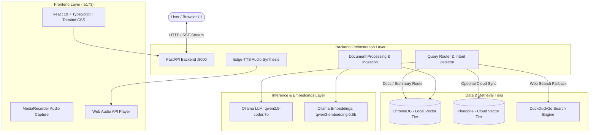
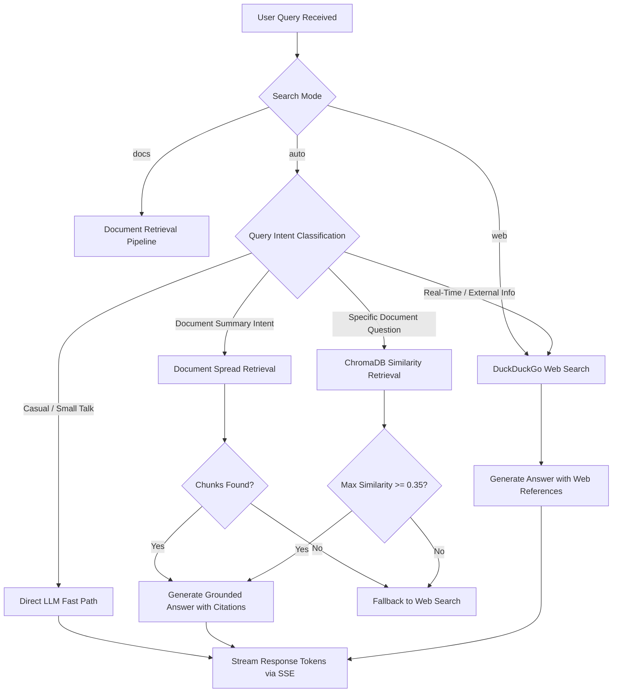
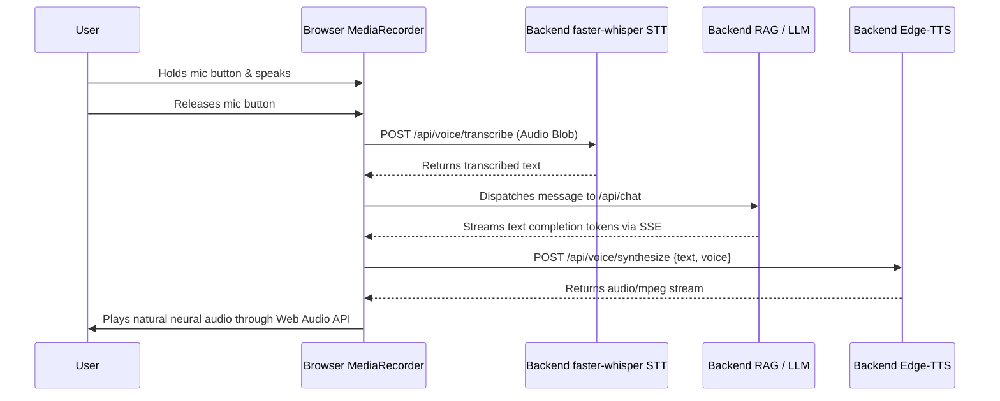

# System Architecture & Technical Specifications

This document outlines the architecture, data flows, routing mechanisms, storage tiers, voice pipeline, streaming specifications, and framework usage in the Local RAG Chatbot.

---

## 1. System Overview & Core Components

The application is structured into a modern full-stack decoupled architecture:



### Core Components:
1. **Frontend (`/frontend`)**:
   - Built with React 19, TypeScript, and Tailwind CSS.
   - Designed with an intentional Claude-style dark palette tinted with nature greens (`--color-bg: #121813`, `--color-accent: #a8d5a2`).
   - Features real-time Server-Sent Events (SSE) parsing, live streaming markdown rendering with syntax highlighting, search mode switching (`auto`, `web`, `docs`), voice transcription & edge-tts synthesis playback, and document management drawers.
2. **Backend (`/backend`)**:
   - Built with FastAPI and Uvicorn.
   - Houses the RAG pipeline, query classifier/intent routing, document ingestion and chunking, vector database abstraction, and web search fallback.
3. **Local Vector Tier (ChromaDB)**:
   - Local on-disk persistent vector database storing vector embeddings and document metadata for zero-cost, private offline retrieval.
4. **Cloud Vector Tier (Pinecone)**:
   - Optional managed cloud vector database for syncing and scaling document indexes across distributed environments.
5. **Local Inference (Ollama)**:
   - Powers text generation via `qwen2.5-coder:7b` (with `num_ctx >= 4096`) and dense embeddings via `qwen3-embedding:0.6b`.

---

## 2. Query Routing & Search Modes

Incoming chat requests pass through an adaptive routing pipeline (`backend/routers/chat.py` and `backend/services/rag_service.py`):



### Search Modes:
1. **`auto` (Intelligent Hybrid Routing - Default)**:
   - **Small Talk / Casual Conversions**: Queries such as "hello", "how are you today", "thanks" are answered directly (`path: "direct"`) without unnecessary search or vector retrieval.
   - **Summary / Broad Document Queries**: Triggers the deterministic spread retriever (see below).
   - **Vector Similarity Search**: Evaluates top chunks against `SIMILARITY_THRESHOLD = 0.35`. If matched, grounds answers in local documents (`path: "document"`).
   - **Web Fallback**: If similarity is below $0.35$ or documents do not exist, routes to DuckDuckGo search (`path: "web"`).
2. **`web` (Strict Real-Time Search)**:
   - Bypasses document retrieval entirely. Queries DuckDuckGo for live sources, snippets, and links, grounding answers in real-time web results.
3. **`docs` (Strict Document RAG)**:
   - Restricts context solely to ingested documents. Even if similarity scores are low, the best document matches or spread chunks are supplied to the LLM without ever falling back to external web searching.

---

## 3. Retrieval Engine & The Spread Route

### A. Cosine Similarity & Threshold (`0.35`)
- When queries target specific facts, vector retrieval computes top-$k$ nearest neighbors using cosine similarity.
- ChromaDB returns cosine distances ($D \in [0, 2]$). These are transformed to similarity scores via:
  $$\text{similarity} = 1.0 - \text{distance}$$
- Mathematically, cosine similarity spans the range $[-1.0, 1.0]$. For orthogonal or divergent vector representations, similarity scores can be zero or slightly negative. The threshold $\max(\text{similarity}) \ge 0.35$ filters out negative, zero, and weak matches, ensuring only semantically grounded document context is supplied to the prompt.
- Sources report exact match percentages (e.g. `Score: 68%`) on frontend source chips for positive matches.

### B. Document-Level Summary & Spread Retrieval Route
Generic overview queries (e.g., *"summarize this paper"*, *"key findings"*, *"what is this document about"*, *"break down the architecture"*, *"analysis of the document"*) naturally score lower on specific dense similarity metrics because their semantics encompass the entire corpus rather than a single passage.

To solve this, the engine employs a specialized **Spread Retrieval Strategy**:
1. **Intent Matching (`is_summary_query`)**: Detects high-level summary and overview phrases paired with document references.
2. **Deterministic Chunk Selection (`get_spread_chunks`)**:
   - Collects all chunks belonging to the target document sorted by page number and chunk sequence.
   - **Skips Reference Sections**: Filters out chunks exhibiting dense citation patterns (e.g., frequent `[1]`, `[2]`, `arXiv preprint`, `et al.`).
   - **Always includes the Abstract**: Selects the first primary content chunk immediately following title/author frontmatter.
   - **Always includes Conclusions**: Captures the final substantive content chunk before references.
   - **Even Spaced Sampling**: Uniformly samples intermediary chunks across intermediate pages up to the requested spread limit (default 8 chunks).
3. **Frontend Integration**:
   - Emits SSE metadata with `"retrieval": "spread"`.
   - The frontend gracefully omits percentage score badges on source chips when retrieval is `"spread"`, indicating holistic rather than point-similarity matching.

---

## 4. Server-Sent Events (SSE) Protocol

The `/api/chat` endpoint streams responses using standard Server-Sent Events (`text/event-stream`).

### Event Lifecycle:
1. `event: status`: Dispatched when routing state changes or search operations commence.
2. `event: sources`: Dispatched once context retrieval is finalized, containing cited documents or web URLs.
3. `event: token`: Dispatched incrementally as the LLM generates tokens.
4. `event: done`: Dispatched when generation is complete, providing conversation ID and final status.

### Event Schemas and Payloads:

#### 1. Status Event
```json
event: status
data: {"status": "searching", "message": "Retrieving document overview..."}
```

#### 2. Sources Event (Document Spread Retrieval Example)
```json
event: sources
data: {
  "path": "document",
  "retrieval": "spread",
  "fallback_reason": null,
  "sources": [
    {
      "source": "attention-is-all-you-need.pdf",
      "page": 1,
      "snippet": "The dominant sequence transduction models are based on complex recurrent or convolutional neural networks...",
      "score": null
    },
    {
      "source": "attention-is-all-you-need.pdf",
      "page": 10,
      "snippet": "In this work, we presented the Transformer, the first sequence transduction model based entirely on attention...",
      "score": null
    }
  ]
}
```

#### 3. Sources Event (Web Search Fallback Example)
```json
event: sources
data: {
  "path": "web",
  "retrieval": "similarity",
  "fallback_reason": "low_similarity",
  "best_score": 0.22,
  "sources": [
    {
      "title": "Quantum Computing Milestones 2026",
      "url": "https://example.com/quantum",
      "snippet": "Recent breakthroughs demonstrate error correction improvements..."
    }
  ]
}
```

#### 4. Token Event
```json
event: token
data: {"token": "The "}
```

#### 5. Done Event
```json
event: done
data: {"status": "complete", "conversation_id": "conv-1793549231"}
```

---

## 5. Dual Storage Tiers: ChromaDB & Pinecone

| Feature | Tier 1: Local ChromaDB | Tier 2: Cloud Pinecone |
| :--- | :--- | :--- |
| **Primary Role** | Fast local storage, privacy-preserving, zero cost | Distributed synchronization, multi-node scaling |
| **Location** | `./backend/chroma_db` (or `./chroma_db`) | Cloud serverless index (`PINECONE_INDEX_NAME`) |
| **Embeddings** | Ollama `qwen3-embedding:0.6b` | Ollama or compatible external embedding pipeline |
| **Sync Mechanism** | Direct ingestion via `/api/documents/upload` | Sync on demand via `/api/sync/pinecone` endpoint |
| **Offline Support** | 100% offline capable | Requires internet connectivity and Pinecone API key |

---

## 6. Voice Pipeline Architecture

The application features full bidirectional voice conversation:



- **Voice Input**: Client audio recorded in the browser using the standard `MediaRecorder` API (`audio/webm`), streamed to the backend `/api/voice/transcribe` endpoint, and transcribed using `faster-whisper` on CPU (INT8 quantization, 0 MB GPU footprint). When `STT_ENABLED=false`, STT modules remain unimported and lazy.
- **Voice Output**: Edge-TTS audio synthesis running on CPU using Microsoft natural neural voices (e.g. `en-US-GuyNeural`, `en-US-AriaNeural`), streamed directly to the browser for instant playback.

---

## 7. Where LangChain is Used

The project leverages LangChain components for document processing, splitting, vector operations, and model abstractions:

| File | LangChain Module / Class | Purpose |
| :--- | :--- | :--- |
| [`backend/routers/documents.py`](../backend/routers/documents.py) | `langchain_community.document_loaders.PyPDFLoader` | Extracts text and metadata page-by-page from uploaded PDF documents. |
| [`backend/routers/documents.py`](../backend/routers/documents.py) | `langchain_community.document_loaders.TextLoader` | Reads raw UTF-8 plaintext, Markdown, and text documents into LangChain Document records. |
| [`backend/routers/documents.py`](../backend/routers/documents.py) | `langchain_text_splitters.RecursiveCharacterTextSplitter` | Splits document bodies into optimal semantic chunks (size: 800, overlap: 150) preserving paragraphs and sentences. |
| [`backend/core/embeddings.py`](../backend/core/embeddings.py) | `langchain_ollama.OllamaEmbeddings` | Generates 1024-dimensional dense vector embeddings using local Ollama (`qwen3-embedding:0.6b`). |
| [`backend/core/embeddings.py`](../backend/core/embeddings.py) | `langchain_google_genai.GoogleGenerativeAIEmbeddings` | Generates 768-dimensional embeddings via Google Gemini (`text-embedding-004`). |
| [`backend/core/embeddings.py`](../backend/core/embeddings.py) | `langchain_openai.OpenAIEmbeddings` | Generates embeddings via OpenAI-compatible endpoints (`text-embedding-3-small`). |
| [`backend/core/vectorstore.py`](../backend/core/vectorstore.py) | `langchain_chroma.Chroma` | Manages local vector collection storage, persistence, and cosine distance query similarity searches. |
| [`backend/core/vectorstore.py`](../backend/core/vectorstore.py) | `langchain_pinecone.PineconeVectorStore` | Integrates cloud Pinecone vector database for cloud synchronization and primary vector retrieval. |
| [`backend/core/llm.py`](../backend/core/llm.py) | `langchain_ollama.ChatOllama` | Interfaces with the local Ollama LLM (`qwen2.5-coder:7b`) with `num_ctx=4096` for streaming grounded completions. |
| [`backend/core/llm.py`](../backend/core/llm.py) | `langchain_google_genai.ChatGoogleGenerativeAI` | Streams chat completions from Google Gemini models (e.g. `gemini-1.5-flash`, `gemini-2.0-flash`). |
| [`backend/core/llm.py`](../backend/core/llm.py) | `langchain_openai.ChatOpenAI` | Streams chat completions from OpenAI and OpenAI-compatible endpoints (Groq, DeepSeek, OpenRouter). |
